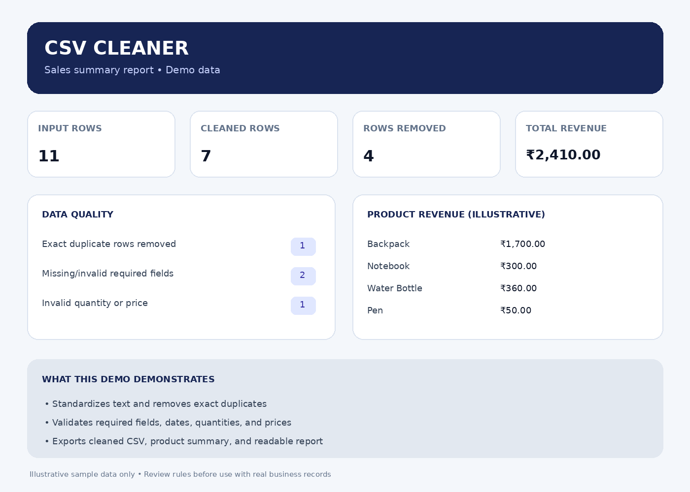

# Python CSV Cleaner & Sales Report Generator

A beginner-friendly Python utility that cleans sales CSV files and produces summary reports using **pandas**.

> Portfolio demo using artificial sample data. Review cleaning rules before using this on real business data.

## Features
- Standardizes customer and product text (trims spaces and normalizes capitalization)
- Removes exact duplicate rows
- Parses dates and numeric fields, identifying invalid values
- Removes rows with missing essential fields or invalid quantities/prices
- Calculates line totals and summarizes revenue by product
- Exports cleaned data, product summary, and a readable text report

## Demo results

The sample file intentionally includes duplicates, inconsistent text formatting, a malformed date, a missing customer, and a zero quantity.

| Metric | Sample result |
|---|---:|
| Input rows | 11 |
| Cleaned rows | 7 |
| Rows removed | 4 |
| Total revenue in cleaned rows | ₹2,410.00 |



These figures describe only the included artificial demo data; they are not real business results.

## Requirements
- Windows 10/11 (or another OS with Python)
- Python 3.10+
- pandas

## Run on Windows

Open PowerShell or the VS Code terminal in this project folder.

Install pandas for the Python interpreter you intend to use:

```powershell
python -m pip install pandas
```

Run the demo:

```powershell
python csv_cleaner.py messy_sales.csv
```

If you use Anaconda and `python` points to another interpreter, use the Anaconda interpreter path, for example:

```powershell
& "C:\ProgramData\anaconda3\python.exe" csv_cleaner.py messy_sales.csv
```

The program creates an `output` folder beside the script.

## Output files
- `output/cleaned_sales.csv` — cleaned rows with calculated `line_total`
- `output/product_summary.csv` — unique orders, units sold, and revenue by product
- `output/sales_summary.txt` — data-quality counts and sales summary

## Expected input columns
The input CSV should contain: `order_id`, `date`, `customer`, `product`, `quantity`, `unit_price`. Column names are normalized to lowercase and spaces become underscores.

## Project structure

```text
python-csv-cleaner/
├── csv_cleaner.py
├── messy_sales.csv
├── README.md
├── sales-summary.png
└── .gitignore
```

## Limitations and safe use
- This is a demo, not a substitute for reviewing important financial records.
- Current rules remove rows with missing essential fields, invalid dates, non-positive quantities, or negative prices. For real client work, agree on rules first and keep an untouched backup.
- Test with a copy before processing important data.
- Do not commit customer data or credentials to this public repository.

## About
Built with Python and pandas as a practical data-cleaning and reporting portfolio project.
